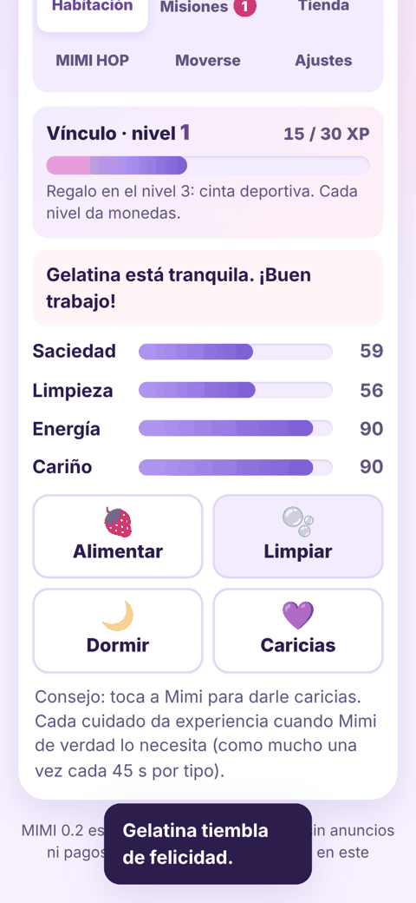
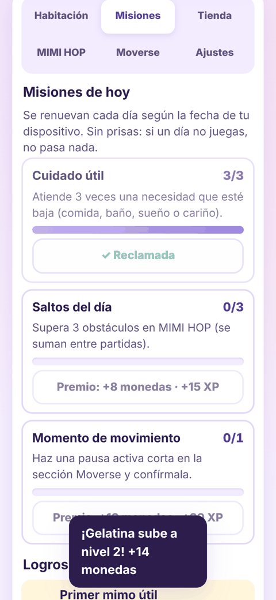
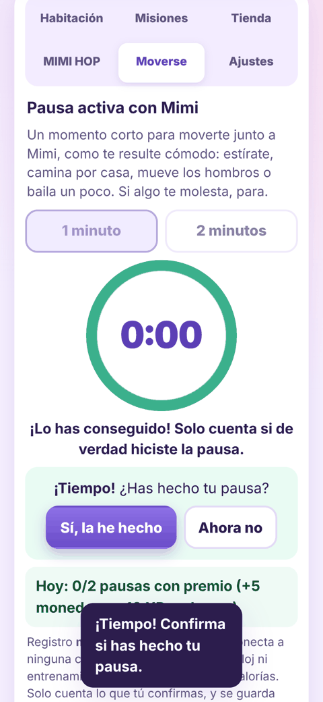
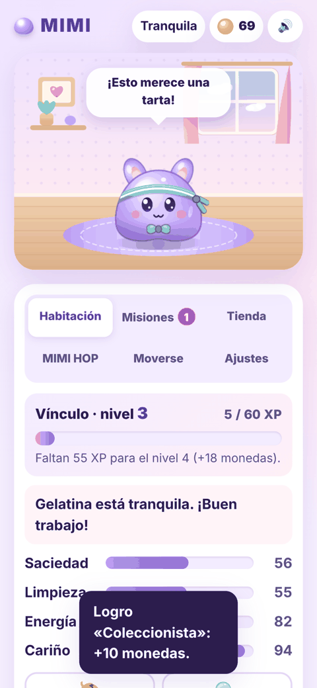
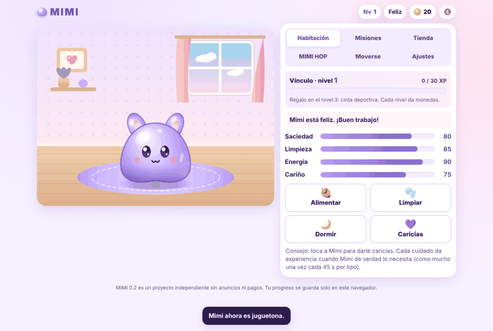

# mimi-game

MIMI: mascota de gelatina lavanda y minijuego MIMI HOP. Phaser, TypeScript y Vite.

**Versión 0.2.0.** Juego web/móvil: cuida a Mimi en su habitación, sube vuestro **nivel de vínculo**, completa
**misiones diarias** y **logros**, haz una **pausa activa** corta con ella, gana monedas en **MIMI HOP** y gástalas en accesorios.
Todo funciona en el navegador: sin backend, sin pagos, sin anuncios, sin IA externa y sin activos de terceros
(Mimi, la habitación, los accesorios y los obstáculos se dibujan con Canvas 2D propio en `src/art/art.ts`;
los sonidos se sintetizan con Web Audio en `src/audio/sfx.ts`, sin archivos).

### Novedades 0.2.0

- **Sonido propio** (Web Audio): caricias, comida, baño, sueño, salto, punto, golpe, compra, misión y subida de nivel.
  Botón 🔊/🔇 siempre visible arriba y volumen en Ajustes (se recuerdan). El audio solo se activa tras tocar/pulsar algo;
  silenciar corta al instante. No hay música ni nada que suene solo. Si el navegador no tiene Web Audio, el juego sigue igual.
- **Vínculo**: experiencia y niveles con barra clara. Cada subida da monedas una sola vez, confeti y salto de celebración.
- **Misiones diarias** (cuidado útil, superar 3 obstáculos acumulados, momento de movimiento) y **7 logros** permanentes con objetivo visible.
- **Más vida**: frases cortas según personalidad y estado, "+XP" flotante, avisos en cola y la **cinta deportiva**,
  regalo al llegar al nivel 3.
- **Moverse** (primer puente con MihaiFIT): pausa activa de 1 o 2 minutos con Mimi moviéndose contigo.
- Pestañas en rejilla 3×2 legibles a 360 px.

## Pila

| Pieza | Versión |
| --- | --- |
| Phaser | `4.2.1` (exacta, fijada en `package.json` y `package-lock.json`) |
| TypeScript | `~5.9.3` |
| Vite | `^8.3.4` (`base: './'`, rutas relativas) |
| Vitest | `^5.0.5` |
| Node | `>= 22.12` |

## Comandos

```bash
npm ci            # instalar exactamente lo del lockfile
npm run dev       # servidor de desarrollo
npm test          # pruebas de estado, economía, persistencia y MIMI HOP
npm run typecheck # tsc --noEmit
npm run build     # typecheck + build de producción en dist/
npm run preview   # sirve dist/
```

## Controles

**Habitación**
- Botones **Alimentar**, **Limpiar**, **Dormir/Despertar** y **Caricias**.
- Tocar o hacer clic sobre Mimi = caricias.
- Botón 🔊/🔇 arriba a la derecha: silenciar/activar sonido.
- Las pestañas se recorren con `←` `→` `Inicio` `Fin`; todo es accesible con teclado y lector de pantalla
  (barras de necesidades con `role="progressbar"`, avisos en región `aria-live`).

**MIMI HOP**
- Saltar: tocar la escena, `Espacio`, `↑`, `W` o el botón **Saltar**.
- El primer salto empieza la partida. Al chocar aparece el resumen con **Reintentar** / **Volver a la habitación**.

**Moverse**
- Elige 1 o 2 minutos, **Empezar**, **Pausar/Continuar** o **Cancelar**. Al acabar el tiempo, confirma si hiciste la pausa.

## Reglas y límites (verificados por pruebas)

**Necesidades** (0–100): Saciedad, Limpieza, Energía y Cariño.
- Bajan con el tiempo real (por minuto: saciedad 1,2 · limpieza 0,8 · energía 0,9 · cariño 1,0, ajustado por personalidad).
- El tiempo acumulado con la app cerrada se **limita a 4 horas**; si el reloj del dispositivo retrocede no se aplica nada.
  Nunca bajan de 0 ni suben de 100. Mimi no enferma ni muere.
- Dormida: energía +5/min y el resto baja a la mitad; se despierta sola al llegar a 100. No come ni se baña dormida.
- Cuidar una necesidad que estaba por debajo de 40 da **+1 moneda**.

**Personalidades** (se eligen al empezar; se pueden cambiar en Ajustes):
- **Juguetona**: pide cariño un 40 % más rápido, caricias +50 %, MIMI HOP +25 % de monedas.
- **Dormilona**: se cansa un 40 % más rápido, dormir recupera +60 %, se ensucia un 20 % más despacio.
- **Glotona**: hambre un 40 % más rápida, comer sacia +30 % y da +8 de cariño.

**Monedas y tienda**
- Se empieza con 20 monedas. Máximo 999 999.
- 7 accesorios de tienda (15–60 monedas) + la cinta deportiva (regalo del nivel 3), en 3 zonas: cabeza, cara, cuello. Uno por zona.
- Comprar sin saldo suficiente se rechaza y dice cuántas monedas faltan: **el saldo nunca es negativo**.
- Lo comprado se equipa automáticamente; volver a pulsar lo quita / lo pone.

**MIMI HOP**
- Cada obstáculo superado = 1 punto. La velocidad sube con los puntos (300 → 640 px/s, tope).
- Recompensa al terminar: `1 + floor(puntos / 2)` monedas, **máximo 40** (×1,25 si es juguetona, redondeo hacia abajo).
- La recompensa se cobra **una sola vez por partida** (cada partida tiene un identificador; repetir el cobro no suma).
- Récord local guardado en el dispositivo. No hay clasificaciones online.
- Cada partida gasta 6 de energía y da 6 de cariño. Con energía < 10 o dormida no se puede jugar.

**Vínculo (XP y niveles)**
- Pasar del nivel *n* al siguiente cuesta `30 + 15·(n−1)` XP (nivel 2 = 30 XP, nivel 3 = 75 XP). Máximo nivel 50.
- Subir a nivel *n* da `10 + 2·n` monedas **una sola vez** (`levelRewarded` guarda el último nivel pagado).
- Nivel 3: regalo de la **cinta deportiva** (cabeza). Se pone sola solo si la cabeza estaba libre; no se puede comprar.
- XP de cuidados: **+5** solo si el cuidado es *útil* (saciedad o limpieza < 70, cariño < 80, energía < 40 al dormir)
  y como mucho **una vez cada 45 s por tipo**. Spamear caricias no da más. Si el reloj retrocede, no se da XP y la espera se reinicia.
- MIMI HOP: `2 + floor(puntos/2)` XP, máximo 15, una vez por partida (mismo identificador que las monedas).
- No hay castigos: la XP nunca baja y no pasa nada por no volver.

**Misiones diarias** (fecha local AAAA-MM-DD)
- Cuidado útil ×3 (+8 monedas, +15 XP) · Superar 3 obstáculos en MIMI HOP, acumulados (+8, +15 XP) · 1 pausa de movimiento (+10, +20 XP).
- Cada misión se reclama **una vez al día**; el estado se guarda, así que recargar no permite cobrar otra vez.
- Se renuevan cuando la fecha local es posterior a la guardada. Si el reloj va **hacia atrás**, se conserva el día guardado (no se renueva ni se duplica nada).

**Logros** (permanentes, se pagan una vez): Primer mimo útil (5), Cuidadora constante (25 cuidados útiles, 15),
Saltarina (10 puntos en una partida, 10), Lazos fuertes (nivel 3, 10), En marcha (primera pausa, 10),
Día redondo (las 3 misiones de un día, 15), Coleccionista (3 accesorios, 10).
Una partida 0.1 que ya cumplía alguno (p. ej. récord ≥ 10) lo recibe una vez al cargarla.

**Moverse (pausa activa)**
- Duración 1 o 2 minutos. Sugerencias suaves que cambian cada 20 s ("estírate", "camina un poco", "baila"…);
  sin repeticiones, calorías ni indicaciones clínicas.
- Solo cuenta con la app **en primer plano**: al ocultar la pestaña/app se **pausa** (nunca se completa sola). Además,
  si entre dos ticks pasan más de 1,5 s (pestaña congelada) ese tiempo no cuenta y queda en pausa.
- Al terminar, la persona confirma "Sí, la he hecho" → +5 monedas y +10 XP, **máximo 2 pausas con premio al día**.
  Cada pausa tiene identificador: confirmar dos veces, recargar o reutilizar una sesión antigua no vuelve a pagar.
- Es un **registro manual y local**: sin cuenta, sensores, pasos, entrenamientos reales ni envío de datos.
- Enlace sencillo a <https://www.mihaifit.es/> (`rel="noopener noreferrer"`, sin parámetros de seguimiento).
  No hay integración con WordPress ni con cuentas de MihaiFIT.

**Guardado local**
- `localStorage` clave `mimi-game.save`, formato `{ version: 2, savedAt, state }`.
- **Migración 0.1 → 0.2 aditiva**: un guardado `version: 1` conserva nombre, personalidad, necesidades, monedas, accesorios,
  equipados, récord y contadores de MIMI HOP; los campos nuevos (XP, misiones, logros…) toman valores por defecto.
  Antes de reescribirlo se guarda una copia exacta en `mimi-game.save.v1` (solo la primera vez).
- Versiones no enteras o < 1 se tratan como dañadas.
- Preferencias de sonido aparte, en `mimi-game.prefs` (`{ sound, volume }`).
- Al cargar se valida y normaliza todo (rangos, tipos, accesorios inexistentes, equipados sin comprar, fechas futuras).
- JSON dañado → partida nueva y copia del original en `mimi-game.save.backup`.
- Guardado de una versión más nueva → no se sobrescribe.
- Sin almacenamiento (modo privado, bloqueado, cuota llena) → se juega igual y se avisa de que no se guardará.

## Estructura

```
src/
  state/   model, care (necesidades, cuidados, recompensas), progress (XP, niveles, misiones, logros),
           movement (pausa activa), voice (frases), personality, shop, storage (+ migración), prefs, store
  audio/   sfx.ts — efectos Web Audio sintetizados
  hop/     hopLogic.ts — física, obstáculos, colisiones y puntuación (pura, sin Phaser)
  art/     art.ts — dibujo procedural de Mimi, accesorios, habitación y escenario
  scenes/  RoomScene, HopScene, MimiRig (capas: respiración, parpadeo, squash/stretch, mirada)
  ui/      ui.ts — interfaz DOM en español
tests/     pruebas Vitest (migración v1, datos dañados, XP/niveles, anti-spam, misiones/fechas/reloj atrás,
           temporizador y segundo plano, audio con AudioContext falso, tienda)
scripts/   smoke.mjs — prueba de humo en Chromium real con WebGL
docs/      capturas de la prueba de humo
```

## Prueba de humo en navegador (`scripts/smoke.mjs`)

Recorre en Chromium con WebGL (móvil 360×780 y escritorio 1280×860): migración de un guardado 0.1, WebGL activo,
audio tras gesto + silenciar/reactivar, cuidado útil y XP con enfriamiento, reclamar misión una sola vez,
pausa activa (pausar, segundo plano simulado, continuar, esperar el minuto real, confirmar una sola vez),
recarga con guardado intacto, partida de MIMI HOP, compra en tienda, subida a nivel 3 con cinta, y que no haya
errores de consola. Tarda ~2 minutos (espera el minuto real de la pausa). Deja capturas en `smoke-shots/`.

Playwright **no** es dependencia del proyecto. Con Playwright instalado globalmente:

```bash
npm run build
npx vite preview --port 4173 &
NODE_PATH="$(npm root -g)" node scripts/smoke.mjs http://localhost:4173/
# o bien: npm i --no-save playwright && npx playwright install chromium && node scripts/smoke.mjs http://localhost:4173/
```

Para probar la migración con un guardado creado por la **0.1 real**, sirve ambos builds en el mismo origen
(p. ej. `site/v1/` = build de la 0.1 y `site/v2/` = build actual) y pasa `V1_URL`:

```bash
V1_URL=http://localhost:4173/v1/ NODE_PATH="$(npm root -g)" node scripts/smoke.mjs http://localhost:4173/v2/
```

Variables opcionales: `SHOTS=<carpeta>` para las capturas y `CHROMIUM_PATH=<ruta>` para usar otro Chromium.
El script usa `window.__mimi` solo para leer el estado y preparar condiciones (necesidades bajas, monedas, XP de prueba).

## Despliegue

`.github/workflows/ci.yml` ejecuta typecheck, pruebas y build en cada PR y push. Solo en `main`
(es decir, tras hacer merge) sube `dist/` y lo despliega con GitHub Pages (Source: GitHub Actions).
Gracias a `base: './'` funciona bajo `https://<usuario>.github.io/mimi-game/`.

## Limitaciones conocidas

- Los sonidos son efectos cortos sintetizados (sin música).
- La pausa activa no se reanuda tras recargar la página (el temporizador vive en memoria; la sesión simplemente no cuenta).
- Las misiones dependen de la fecha del dispositivo: adelantar el reloj adelanta la renovación (es un juego local, sin servidor).
- El bundle de Phaser pesa ~1,4 MB (≈ 373 kB gzip); no se ha optimizado la carga.
- El progreso vive solo en el navegador del dispositivo: no se sincroniza entre dispositivos.

## Capturas (prueba de humo, Chromium + WebGL)

| Habitación (360 px) | Misiones | Moverse | Cinta deportiva |
| --- | --- | --- | --- |
|  |  |  |  |


